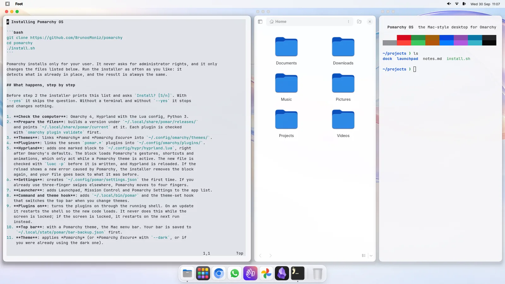
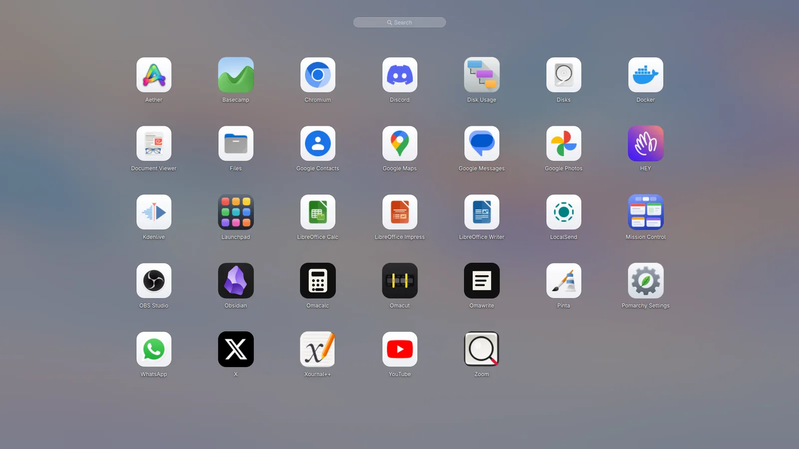
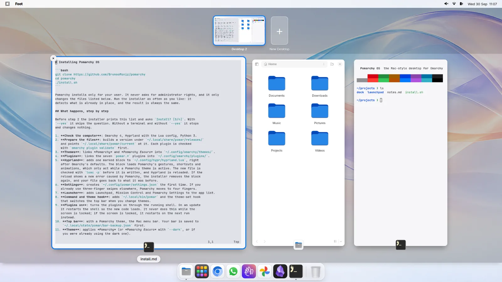
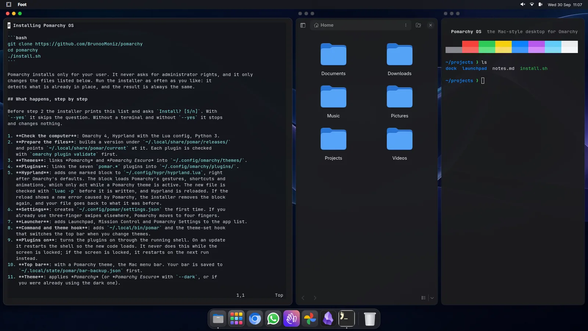
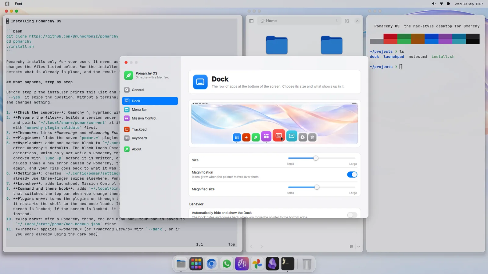

# Pomarchy OS

A Mac-style desktop for [Omarchy](https://omarchy.org) 4: a Dock, Launchpad,
Mission Control, window buttons, a Mac menu bar and trackpad gestures. It
installs in one step, and one command undoes it.



▶ **[Watch the one-minute demo](https://github.com/BrunooMoniz/pomarchy/releases/download/v0.1.0/pomarchy-os-demo-en.mp4)**
· [vídeo em português](https://github.com/BrunooMoniz/pomarchy/releases/download/v0.1.0/pomarchy-os-demo-pt.mp4)

## What you get

- **Dock**: favorites, running apps and minimized windows, with magnification,
  auto-hide, a Trash and the genie effect when you minimize.
- **Launchpad**: every installed app on one page, with search and pages.
  Open it with a four-finger pinch or `Super+Alt+Space`.
- **Mission Control and App Exposé**: live thumbnails of every window and
  desktop. Open it with a three-finger swipe up or down, or `Super+Ctrl+↑`
  and `Super+Ctrl+↓`. The gesture follows your fingers. You can drag windows
  between desktops and close them with the ✕.
- **Window buttons**: close, minimize and zoom above every tiled window, as on
  a Mac. A tab group gets one set of buttons.
- **Mac menu bar**: the system menu (with the Omarchy menu, keybindings and
  screen capture inside), the active app and its menus, and the Omarchy
  workspaces.
- **Alt+Tab** app switcher (`Alt` sits where `⌘` is on a Mac keyboard).
- **Two themes**: *Pomarchy* (light) and *Pomarchy Escuro* (dark), each with
  its own wallpapers.
- **Settings and a welcome tour**. The desktop speaks English or Portuguese
  and follows your system language.

Omarchy's own shortcuts stay: `Super+Space`, `Super+K`, `Print` and
`Alt+Print`. Pick any other Omarchy theme and everything goes back to plain
Omarchy, including your original top bar. Pick a Pomarchy theme again and the
Mac bar returns.

| | |
|---|---|
|  |  |
|  |  |

## Requirements

- Omarchy 4 (Quattro) with Hyprland 0.56 and its Lua config (`~/.config/hypr/hyprland.lua`)
- Python 3 and git (both come with Omarchy)

Pomarchy is developed and tested on Omarchy 4.0, Hyprland 0.56.2 and Quickshell 0.3.
It installs only for your user and never asks for administrator rights.

## Install

```bash
git clone https://github.com/BrunooMoniz/pomarchy
cd pomarchy
./install.sh
```

The installer lists everything it will change and asks once before it touches
anything. Answer "n" and nothing changes. Whatever it replaces goes to
`~/.local/state/pomar/backup/`. To update, run `git pull` and `./install.sh`
again. The result is the same every time you run it.

| Option | What it does |
| --- | --- |
| `--yes` | install and apply without asking |
| `--no-apply` | install, but keep your current theme for now |
| `--no-bar` | leave the Omarchy top bar alone, also on later theme changes |
| `--dark` | use the dark theme (Pomarchy Escuro) |
| `--lang en` / `--lang pt` | the installer's language |

The installer, the uninstaller and the `pomar` command speak English, or
Portuguese when your system or Pomarchy is set to Portuguese (or with
`--lang pt`). The desktop follows your language too.
[docs/install.md](docs/install.md) describes each step.

## What the installer changes

- `~/.local/share/pomar/`: the installed version (`current` points to the one in use).
- `~/.config/omarchy/themes/pomarchy*` and `~/.config/omarchy/plugins/pomar.*`: links to that version.
- `~/.config/hypr/hyprland.lua`: one marked block (`-- >>> pomar >>>` … `-- <<< pomar <<<`) right after
  Omarchy's defaults. It only acts while a Pomarchy theme is active. The file is checked with `luac` before
  it is written, and if Hyprland complains the installer takes the block out again.
- `~/.config/omarchy/shell.json`: turns the Pomarchy plugins on and, with the Mac bar, rearranges the top bar.
  Your bar is saved first and comes back when you leave Pomarchy or uninstall.
- `~/.config/omarchy/hooks/theme-set.d/50-pomarchy`: switches the bar when you change themes.
- `~/.config/pomar/settings.json`: your Pomarchy settings, created once.
- Launcher entries in `~/.local/share/applications/`, icons in `~/.local/share/icons/`,
  and the `pomar` command in `~/.local/bin/`.

## Use

| | Trackpad | Keyboard |
| --- | --- | --- |
| Mission Control | 3 fingers up | `Super+Ctrl+↑` |
| App Exposé | 3 fingers down | `Super+Ctrl+↓` |
| Switch desktop | 3 fingers sideways | as in Omarchy |
| Launchpad | 4-finger pinch | `Super+Alt+Space` |
| Switch apps | | `Alt+Tab` |
| Minimize to the Dock | yellow button | `Super+M` |
| Hide or show the Dock | | `Super+Alt+D` |

If you already use three fingers for something else, the installer moves
Pomarchy to four fingers and tells you. Search for "Pomarchy Settings" in the
launcher to change gestures, the Dock and the window buttons.

```bash
pomar doctor        # checks the installation and explains how to fix what is wrong
pomar bar mac       # Mac menu bar
pomar bar restore   # your Omarchy bar, exactly as it was
pomar help          # everything else
```

## Uninstall

```bash
~/.local/share/pomar/current/uninstall.sh
```

This brings back your previous theme and your top bar, and restores
`~/.config/hypr/hyprland.lua` byte for byte. Minimized windows come back to
your desktop first. Your Pomarchy settings (`~/.config/pomar`) stay. Add
`--purge` to delete them and the downloaded versions too. Backups stay in
`~/.local/state/pomar/backup/`. [docs/uninstall.md](docs/uninstall.md) has
the details.

## Only the themes

The two themes are also published on their own, for the Omarchy theme picker:

```bash
omarchy theme install https://github.com/BrunooMoniz/omarchy-pomarchy-theme
omarchy theme install https://github.com/BrunooMoniz/omarchy-pomarchy-escuro-theme
```

On their own they bring the colors and wallpapers. The Dock and everything
else come with the installer above.

## Tests

```bash
python3 -m unittest discover -s tests
```

The tests never touch your desktop. They run in a temporary home, with stand-ins
for the Omarchy and Hyprland commands, and a nested Hyprland on a virtual output
that clicks with a virtual pointer. At the end they check that nothing in your
real home changed. `POMAR_SKIP_E2E=1` skips the nested Hyprland tests, which
also need `gcc` and `wayland-scanner`.

## Third-party

- `tests/vpointer/wlr-virtual-pointer-unstable-v1.xml` comes from
  [wlr-protocols](https://gitlab.freedesktop.org/wlroots/wlr-protocols),
  © 2019 Josef Gajdusek, under the MIT license (the notice is in the file).

## License

[MIT](LICENSE) © 2026 Bruno Moniz

---

## Em português

O Pomarchy OS é o Omarchy 4 com jeito de Mac: Dock com o efeito gênio,
Launchpad, Mission Control com gestos, botões de fechar, minimizar e ampliar nas
janelas, barra de menus do Mac e Alt+Tab. O melhor do Omarchy continua: os
atalhos, o menu e a gravação de tela. Com outro tema do Omarchy, tudo volta a
ser o Omarchy de sempre, inclusive a barra de cima.

```bash
git clone https://github.com/BrunooMoniz/pomarchy
cd pomarchy
./install.sh --lang pt
```

O instalador mostra tudo o que vai mudar e pergunta antes de começar; o que ele
substitui vai para `~/.local/state/pomar/backup/`. Ele fala português quando o
sistema ou o Pomarchy estão em português, ou com `--lang pt`. Para desfazer:
`~/.local/share/pomar/current/uninstall.sh`. Passo a passo em
[docs/pt/instalar.md](docs/pt/instalar.md) e
[docs/pt/desinstalar.md](docs/pt/desinstalar.md).

Os temas também estão sozinhos, para o seletor de temas do Omarchy:
`omarchy theme install https://github.com/BrunooMoniz/omarchy-pomarchy-theme`
(e `omarchy-pomarchy-escuro-theme`). Sozinhos, trazem as cores e os papéis de
parede; o Dock e o resto vêm com o instalador.
